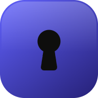
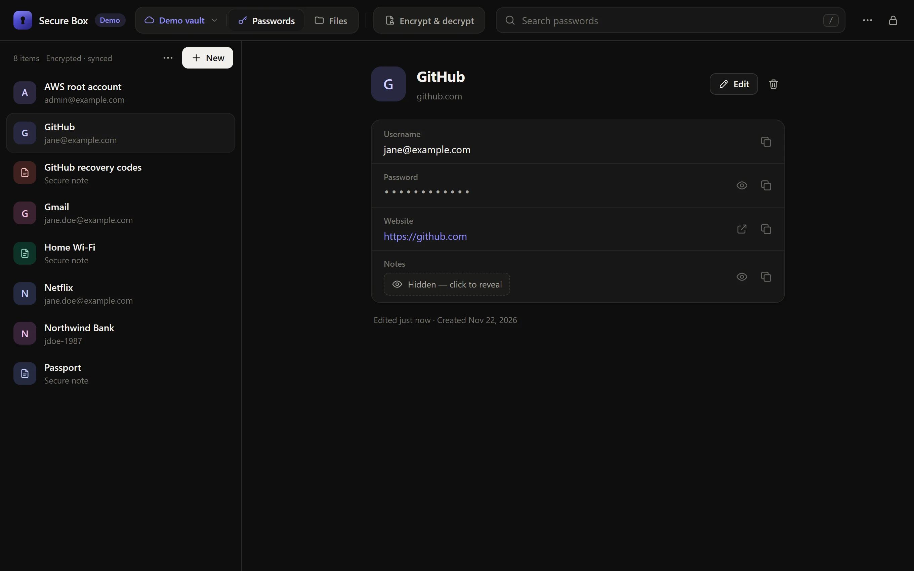
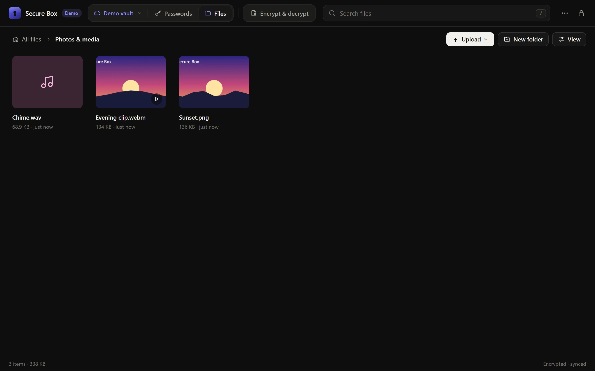
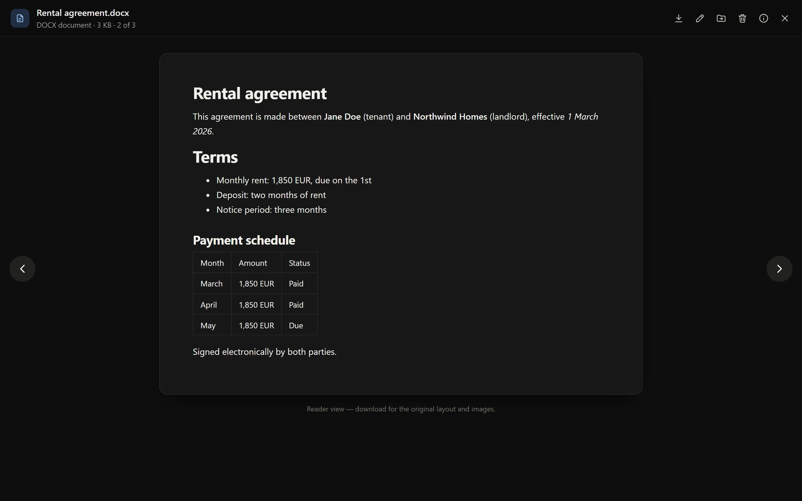
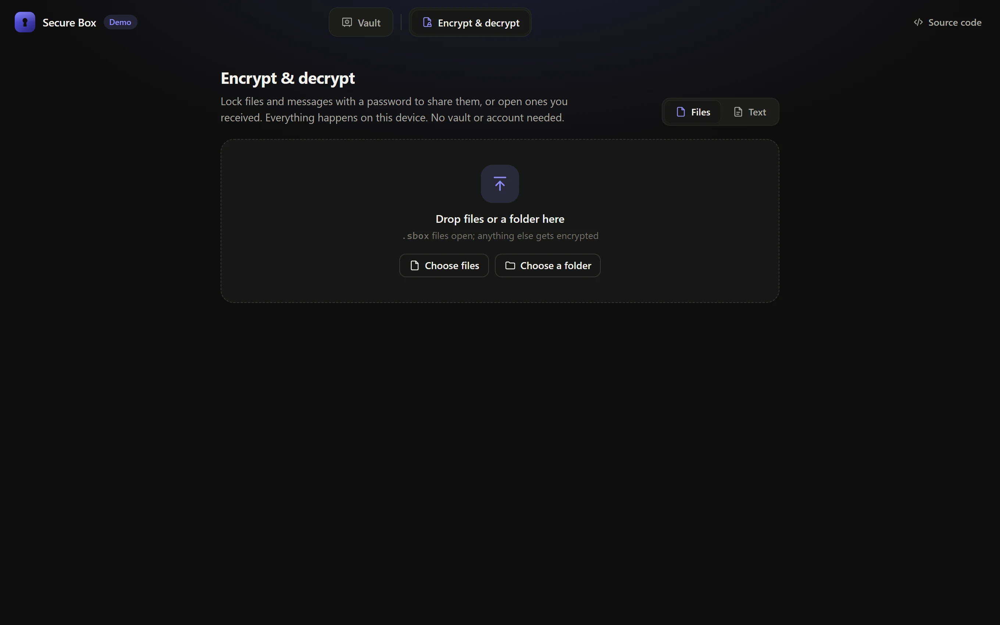
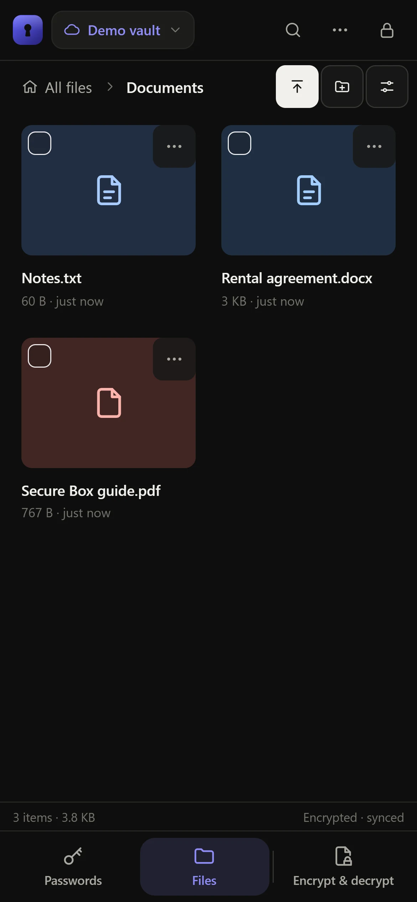
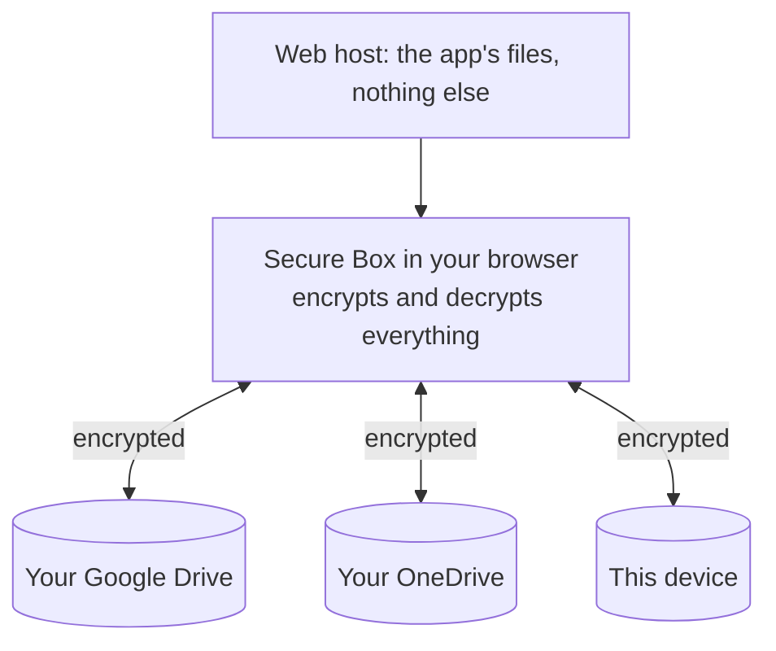

<div align="center">



# Secure Box

**Your passwords, notes and files, encrypted in your browser and kept where you choose:<br>your own Google Drive, your OneDrive, or only on your device.**

[**Open Secure Box**](https://box-6sd93.web.app) · [Try the demo](https://box-6sd93.web.app/?demo) · [Why you can trust it](#why-you-can-trust-it) · [Run your own copy](#run-your-own-copy)

[](https://github.com/CybermindDBS/secure-box/actions/workflows/test.yml)
[](LICENSE)
[](#how-it-works)
[](#check-it-yourself)

</div>

<p align="center"></p>

Secure Box is a free, open-source password manager and encrypted file vault that runs entirely in your web browser. There's no Secure Box server and no Secure Box account. Everything is encrypted on your device with your master password before it's stored, and it's stored somewhere you already own: your Google Drive, your OneDrive, or your device itself. Whoever hosts Secure Box only serves the app's files. They never see your data, and neither do Google or Microsoft.

The [demo](https://box-6sd93.web.app/?demo) opens a vault of sample data that lives only in your browser tab: nothing to sign up for, nothing stored.

## Why you can trust it

- **Every line is open.** The whole app is in this repository, under the GNU AGPL v3. There's no hidden server code, because there is no server.
- **Only you hold the key.** Your master password never leaves your device. Encryption happens in your browser, with its built-in WebCrypto: AES-256-GCM, and keys stretched with PBKDF2 (600,000 rounds).
- **Your data stays in your storage.** A vault lives in your own Google Drive or OneDrive, or only on your device. Google and Microsoft see encrypted files: no names, no contents, no keys.
- **No trackers, no third-party code.** No analytics, no ads, no scripts, fonts or images from anywhere else. A strict Content-Security-Policy lets the page talk only to its own address and to Google's and Microsoft's sign-in and storage.
- **Tested on every change.** 92 unit tests run on every push to `main` and every pull request, from the key ring to the file formats, and a deploy stops if the build's security check fails.
- **Honest about its limits.** Secure Box hasn't had an independent security audit yet. What it can't protect you from is written down under [Honest caveats](#honest-caveats).

### Check it yourself

You don't have to take anyone's word for this:

1. **Watch the network.** Open Secure Box, press <kbd>F12</kbd> and open the **Network** tab. Apart from the app's own files, it only talks to Google's or Microsoft's sign-in and storage, and only for the cloud you chose.
2. **Read the policy.** The same list is in the page's `Content-Security-Policy` header, and your browser enforces it: the page can't load code from, or send requests to, any other address.
3. **Read the code.** The cryptography is in a few small files: [`crypto.js`](src/core/crypto.js), [`keyring.js`](src/core/keyring.js), [`vault.js`](src/core/vault.js) and [`fileformat.js`](src/core/fileformat.js).
4. **Run your own copy.** Deploy this repository to your own free Firebase site, with your own Google project. Then you depend on nobody's server but your own ([how](#run-your-own-copy)).

## A look inside

<table>
  <tr>
    <td width="50%"><br><sub><b>Files.</b> Thumbnails are made on your device; videos stream with seeking.</sub></td>
    <td width="50%"><br><sub><b>Built-in viewers.</b> Documents, photos, video and more open inside Secure Box.</sub></td>
  </tr>
  <tr>
    <td><br><sub><b>Encrypt & decrypt.</b> Share files and messages with a password, no account needed.</sub></td>
    <td align="center"><br><sub><b>On your phone.</b> Made for touch, and installable as an app.</sub></td>
  </tr>
</table>

## What it does

**Passwords and notes**
- Logins and secure notes, with a password generator.
- Copy buttons that clear the clipboard after 30 seconds.
- Import and export CSV from Chrome, Firefox, Bitwarden, 1Password, LastPass and others.

**Files**
- Upload files and whole folders, organise them in folders, and search across all of them.
- Open them right there: photos, video and audio (streamed, with seeking), PDF, Word, Excel, PowerPoint, OpenDocument, EPUB, RTF, Markdown, CSV, text and code. Edit `.txt` files in place.
- Download a file, or several as one ZIP that's built while it downloads.
- Files are decrypted as they stream: nothing decrypted is written to disk.

**Encrypt & decrypt, no account needed**
- Turn files or folders into `.sbox` files, and text into encrypted messages, to keep or to share with a password.
- Whoever you send them to opens them in the same tab, with no account and no vault.

**Your vault, wherever you want it**
- In Google Drive or OneDrive, to have it on all your devices. Or only on this device: in the browser, or in a folder you choose.
- One master password for all your vaults. Switch between them without typing it again.
- **Move or copy** a vault to another place, encrypted the whole way.

**Safety nets**
- An Emergency Kit resets a forgotten master password.
- Backups for a vault on your device, and recovery from the Google Drive bin or the OneDrive recycle bin.
- A clear message and a way back for whatever goes missing: a deleted vault, a deleted file, a vault moved from another device, even a change in how Secure Box connects to your cloud.

**Everywhere**
- Computers, tablets and phones, with touch gestures. Install it as an app.
- Several windows share one unlocked session, and lock together.

## How it works



A vault is the same three parts wherever it lives:

| Part | What's in it |
|---|---|
| `Secure Box Key Ring.json` | Your master key, locked with your master password, and separately with your Emergency Kit |
| `Secure Box Vault.json` | Your passwords, notes, file names and folders, encrypted |
| `Encrypted files/` | One encrypted file for each file you store, under a random name |

Because it's the same everywhere, Secure Box moves a vault by copying these files exactly as they are. A vault's folder downloaded from your cloud's website is a complete backup.

## Security model

| What | Stored as | Who can read it |
|---|---|---|
| Master password | Nowhere; only in your head | You |
| Master key (256-bit) | The key ring, **encrypted** twice: with your master password, and with your Emergency Kit's recovery key | Someone who can reach a vault **and** knows your master password or has your Emergency Kit |
| Passwords, notes, file names, folders | `Secure Box Vault.json`, encrypted | Same as above |
| Files | `Encrypted files/<random name>`, one opaque file each | Same as above |

- **Master password.** It is stretched with PBKDF2-SHA-256 (600,000 rounds) into a key that unlocks the master key. It's never stored or sent anywhere. Changing it re-locks the master key without re-encrypting anything else.
- **Emergency Kit.** A random 256-bit recovery key that can also unlock the master key. Making a new kit stops the old one from working.
- **Vault.** Encrypted with AES-256-GCM. Every save uses a brand-new key, derived from the master key with HKDF and a fresh salt, and its size is padded with the Padmé scheme, so the file size gives little away.
- **Files.** Every file gets its own random 256-bit key, kept only inside the encrypted vault. Files are encrypted in 1 MiB chunks with the same streaming scheme as Google's Tink library, so tampering, truncation, reordering or swapping is detected. Sizes are padded (at most about 12% extra). Photo and video thumbnails are made on your device and encrypted inside the same file.
- **`.sbox` files and messages.** Each gets its own random key, kept in locked copies: one for your account (derived from your master key), and one for a sharing password (PBKDF2, with a salt of its own for every file). The name, size and date are encrypted inside.

<details>
<summary><b>More detail:</b> the key ring, saving from several devices, streaming, what runs where</summary>

**Key ring.** The file that holds your master key, locked twice. On its own it opens nothing. All your vaults share one master key, so each keeps a copy of the same key ring.
- Every change (a new master password, a new Emergency Kit) gives it a higher revision number, signed with the master key itself together with the time of the change. An old copy can't pass for a newer one, and two copies changed apart settle on the later change, the same way everywhere.
- Whenever Secure Box can reach two copies, the newest replaces the older ones. A vault that still has your previous master password says so, and takes the new one once you've entered the old one.

**Saving from several devices.** A save is made on top of the newest vault, and a change carries only what it changes (a name, a folder, the fields you edited), so another device's edits to the rest stay. Google Drive can't refuse a write that comes second, so after each save Secure Box checks Drive's revision history; if another device saved at the same moment, it saves again on top of that.

**Where a vault finds its files.** The vault names each encrypted file itself and never records a Google Drive or OneDrive file id. Google Drive finds a file by a private tag Secure Box puts on it; OneDrive and this device find it by its name in the `Encrypted files` folder. A vault on this device is encrypted exactly like a cloud vault, and its vault file is sealed with a key of its own purpose (HKDF), so it can never pass for a cloud vault, or the other way round.

**Streaming without disk.** A service worker, a small background script your browser runs for Secure Box, decrypts each file chunk by chunk as it streams in, using byte ranges so seeking works. Decrypted data is marked `no-store`, and nothing is written to the browser's storage. Only an explicit **Download** saves a file.

**What runs where.** Encryption uses the browser's own WebCrypto, which works off the page on a thread of its own, at about a gigabyte a second for AES-GCM on a laptop. A small pool of workers reads documents for the viewer, makes thumbnails, and packs folders and backups into ZIPs, so the page stays responsive. With a cloud, the slow part is waiting on the network, so Secure Box keeps several requests going at once: three uploads, three copies when moving a vault, and up to four small files ahead while a ZIP downloads.

</details>

### The page itself

- A strict Content-Security-Policy, the same in development and in the build, and checked before every deploy. Trusted Types allow exactly Secure Box's own script URLs: its service worker and workers.
- Built with React and Vite from a locked list of dependencies, installed with `npm ci --ignore-scripts`. React renders through DOM calls only, and a test fails if anything in `src/` could turn text into markup or code.
- No third-party JavaScript, fonts or images: everything comes from Secure Box's own address.
- It refuses to run inside a frame. The host also sends the policy as HTTP headers, together with HSTS, `frame-ancestors 'none'`, `X-Frame-Options`, `nosniff`, a cross-origin opener policy and `no-referrer` (see [`firebase.json`](firebase.json)).

### Sign-in and permissions

- **Google Drive:** only the `drive.file` permission, so Secure Box sees the files it made itself and nothing else in your Drive. Google's access lasts an hour; after that, **Reconnect** is one click and your vault stays unlocked.
- **OneDrive:** Microsoft's authorization code flow with PKCE, and only `Files.ReadWrite.AppFolder`, so Secure Box sees its own folder (`Apps/Secure Box`) and nothing else. Access renews in the background for up to 24 hours.
- Once you've signed in on a browser, Secure Box signs in again by itself next time, so only your master password is asked. It remembers only which account you used.

### Sessions

- Auto-lock after 10 minutes without activity, and after 8 hours in any case. Locking reloads the page, which drops every key and secret from memory. Copied passwords are cleared from the clipboard after 30 seconds.
- Secure Box windows in one browser share a single unlocked session. The key passes between them in memory only, over a channel only Secure Box's own pages can use, and locking one locks them all.
- Uploads, downloads and work on a vault (a move, a backup) hold the automatic lock until they finish. **Lock** asks first while anything is unfinished.

### Who can see what

- **Google or Microsoft:** that you store some encrypted files, their approximate sizes, and when they change. Not names, folders, contents or keys.
- **The web host:** requests for the app's files, as any web host logs them. Nothing else.

### Honest caveats

- **Without your master password *and* your Emergency Kit, your data is gone.** Nobody can recover it, including you. Keep the kit offline, never in your cloud or your email.
- Use a strong master password, and protect your Google or Microsoft account with two-step verification. An attacker needs both.
- Like any web app, Secure Box can't protect you from malware on your device or a malicious browser extension.
- A hosted copy runs the code deployed to it. If you'd rather not trust the people hosting it, [run your own copy](#run-your-own-copy) from this repository.
- Google sign-in uses Google's OpenID Connect *implicit* flow, which needs no Google script in the page. Google still documents it, and its own browser library uses it too. If Google ever retires it, only [`google.js`](src/core/google.js) needs to change.
- What Secure Box can see in your cloud is tied to its Google Cloud project and Microsoft app registration. If either ever changes, Secure Box brings your vault over from the old one, or takes it back from your cloud's own download ([Recovery](#recovery)).
- OneDrive files are read first through Microsoft Graph's `contentStream`, which is still in beta, then through download links or the `/content` redirect. Those download addresses are allowed by name in the policy, so a new Microsoft download domain needs an update there.
- No independent security audit yet. To report a problem, see [SECURITY.md](SECURITY.md).

## Get started

1. Open [Secure Box](https://box-6sd93.web.app), or your own copy. On the **Vault** tab, choose **Google Drive**, **OneDrive** or **This device**.
2. **Create your master password.** Use 12 or more characters; a short sentence only you would think of works well. Don't save it in your browser.
3. **Save your Emergency Kit** and keep it offline: print it, or copy the recovery key somewhere safe.

**Install it as an app.** It opens in its own window, and browsers are more willing to keep a vault on your device safe.
- **Chrome or Edge on a computer:** the install icon in the address bar, or the browser menu → **Install Secure Box**.
- **Android:** the Chrome menu → **Add to Home screen** or **Install app**.
- **iPhone and iPad:** in Safari, **Share → Add to Home Screen**.

**Browsers.** Recent Chrome, Edge, Firefox and Safari, on computers and phones. Keeping a vault in a folder you choose needs Chrome or Edge on a computer, or Chrome on Android. On iPhone and iPad, a vault on the device works in the Home Screen app, as Safari clears websites' data after 7 days without a visit.

<details>
<summary><b>The full guide:</b> vaults, moving, passwords, files, the viewer, Encrypt & decrypt, keys</summary>

### Where your vault lives

- **Google Drive** or **OneDrive** (recommended): on all your devices, and safe if you lose one.
- **This device**: no account needed, but nothing syncs, so you back it up yourself.

A place with no vault yet asks one question: **Is this your first Secure Box vault?**
- **Yes, it's my first:** create a master password. It opens this vault and any you add later.
- **No, I already have one:** say where one of your vaults is (Google Drive, OneDrive, this device, or a key ring backup file), then enter its master password. The new vault shares its master password and Emergency Kit.

After that, Secure Box opens the vault you used last. The name next to **Passwords** and **Files** says which one is open; click it to switch. A cloud asks you to sign in once, a new place is set up with your current master password, and you never type the password again to switch.
- **A vault with its own key ring** (set up separately, so it has its own master key even if its password is the same) asks for its own master password when you switch to it. The vault menu marks it "own master password".
- **Downloads keep going when you switch.** Uploads belong to their vault, so switching asks first and stops them.
- **Nothing leaves you stuck.** Every error screen has **Open another vault**. A vault deleted or moved outside Secure Box (its folder deleted, this site's data cleared, the folder put in the Google Drive bin) says so, and offers the way back: **Try again**, **Restore it** (from the bin), **Find the folder…**, **Restore a backup…**, or **Save it again** from what's open.

### Moving or copying a vault

**⋯ → Move or copy this vault…** takes the open vault to Google Drive, OneDrive, this device (in this browser, or a folder you choose), or another account of the same cloud.
- **How.** Secure Box copies the vault as it's stored, encrypted the whole way, then reads it all back from there and checks it.
- **Move or copy.** *Move* opens your vault from the new place, and only then clears the old one. *Copy* keeps both, and from then on each changes on its own.
- **After a move,** a cloud keeps a short note of where the vault went, and its files go to its bin. Your other devices that open it there are told **Your vault moved**, and can open it in its new place.
- **A place that already has a vault** is never lost. An earlier copy of this vault is brought up to date. A vault with your master password can be **combined** (where both have the same thing, the version changed last wins) or **replaced** (it goes to the bin first). A vault with its own master password can be combined once its password opens it. Something that can't be read can only be replaced.
- **Safe to stop.** Nothing at the old place changes until your vault opens from the new one. **Try again** picks up where it stopped; **Close** removes what was copied so far.

### Passwords

- Logins and secure notes, with a password generator. **New** is at the top of the list.
- Copy buttons that clear the clipboard after 30 seconds.
- Import and export CSV from Chrome, Firefox, Bitwarden, 1Password, LastPass and others, from the **⋯** button at the top of the list.

### Files

- **Upload ▾** sends several files (**Files…**, or <kbd>U</kbd>) or a whole folder (**A folder…**). To upload several folders, or folders and files together, drag them onto the window. Their folder structure is kept, and the upload panel shows the whole batch at a glance.
- Only files uploaded through Secure Box are encrypted. A file you put into its folder in your cloud yourself stays unencrypted, and Secure Box can't even see it.
- **Organise** with folders, breadcrumbs and search across every folder. **View** holds grid or list, sorting and thumbnails.
- **Select** with checkboxes, <kbd>Ctrl</kbd>/<kbd>⌘</kbd>-click or <kbd>Shift</kbd>-click (on a phone, long-press one, then tap more), or by dragging a box around them. Then Download, Move or Delete them together. Drag items onto a folder or a breadcrumb to move them.
- **Download** a file as itself, or several items as one `.zip` that keeps their folders. The ZIP is built and decrypted while it downloads, and your browser shows its real size and progress.
- **A file whose encrypted copy was deleted** outside Secure Box is marked **Encrypted copy missing**, and opening it says how to put it back, or offers **Remove from vault**.

### The viewer

- <kbd>←</kbd> and <kbd>→</kbd> move through a folder; swipe on a phone or tablet.
- **Images:** zoom with <kbd>+</kbd> and <kbd>−</kbd>, <kbd>Ctrl</kbd>/<kbd>⌘</kbd> + scroll or a double-click, and press <kbd>R</kbd> to rotate. On touch screens, pinch, double-tap and drag.
- **Video and audio:** players with seeking.
- **Documents:** PDFs in the browser's own viewer, or the built-in PDF.js reader where the browser has none (Android, iPhone and iPad), and reader views for Word, Excel, PowerPoint, OpenDocument, EPUB, RTF, Markdown, CSV and JSON.
- **Text and code:** shown as a clean page, with **Monospace** for code. **Edit** turns a `.txt` file into a text box right in the viewer; **Save** (<kbd>Ctrl</kbd>+<kbd>S</kbd>) encrypts the new text in your browser, keeping the file's encoding and line breaks. Files up to 2 MB can be edited.
- Formats your browser can't play say so, and offer **Download**, or **Open in another app** where the browser can hand files over.

### A vault on this device

- **Where it lives.** In Chrome and Edge on a computer, and in Chrome on Android, you choose: **in this browser** (the browser's private storage for Secure Box), or **in a folder you choose** (ordinary encrypted files you can see and copy). Elsewhere, it's in the browser.
- **Keeping it safe in the browser.** The browser deletes this storage if someone clears this site's data, and may clear it by itself when space runs low, unless it grants Secure Box *persistent storage* (browsers usually do for an installed app). The bar above your files shows whether it's protected, and has **Protect** to ask again.
- **Back up** saves the whole vault as one `.zip`, still encrypted, to keep anywhere. The bar reminds you when it's out of date.
- **Restore a backup.** On a new phone or computer, choose **This device → Restore a backup…**. It also takes a vault's "Secure Box" folder as Google Drive or OneDrive download it from their websites (choose every ZIP file, if there are several). In an open vault, **⋯ → Restore a backup…** adds back whatever is missing, and never replaces or deletes anything.
- **Files put in by hand** into a folder vault are listed, with **Encrypt them**.
- **Delete this vault** (**⋯ → Delete this vault…**) deletes it from this device. Anything else in a chosen folder stays.

### Encrypt & decrypt

A tab of its own, there whether or not a vault is open. Everything happens on your computer or phone, and nothing is uploaded.
- **Files:** drop files or a folder in. Each file becomes its own `.sbox`, and a folder becomes one. Your originals aren't changed.
- **Who can open it.** With a vault open, you can, with your master password, and you can add a **sharing password** for someone else. With no vault open, a password is required. Generate one with a click, and send it separately from the files.
- **Hide file names** (on by default) gives each `.sbox` a random name.
- **Text:** switch to **Text** to turn a message into a block you can paste anywhere, or to read one.
- **Key ring backup** (**⋯ → Key ring backup**) opens your `.sbox` files and messages on any device, together with your master password or Emergency Kit.

### Keys and menu

- <kbd>/</kbd> or <kbd>Ctrl</kbd>+<kbd>K</kbd> searches; <kbd>N</kbd> makes a new item or folder; <kbd>U</kbd> uploads; <kbd>?</kbd> shows every shortcut.
- In Files, the arrow keys, <kbd>Home</kbd> and <kbd>End</kbd> move, with <kbd>Shift</kbd> to select; <kbd>Enter</kbd> opens, <kbd>F2</kbd> renames, <kbd>Delete</kbd> deletes.
- **⋯** holds **Sync now**, **Move or copy this vault…**, backups for a vault on this device, **Change master password**, **New Emergency Kit**, **Key ring backup**, **Source code** and **Lock**.
- Your browser's **Back** and **Forward** buttons move between tabs and folders and close the viewer.

</details>

## Recovery

| Problem | Fix |
|---|---|
| Forgot the master password | On the unlock screen, choose **Forgot master password?**, load your Emergency Kit, then set a new password. |
| Lost the Emergency Kit | While unlocked, use **⋯ → New Emergency Kit**. |
| Deleted the Secure Box folder, or a file of it, in Google Drive | Open your vault: Secure Box finds it in the bin and offers **Restore it**. Google Drive keeps it 30 days. |
| Deleted it from OneDrive | Restore it from the OneDrive recycle bin, then choose **Try again**. |
| Deleted the vault's folder on this device | Restore it from the Recycle Bin (the Trash on a Mac), then choose **Try again**. If you moved it instead, choose **Find the folder…**. |
| Deleted it while it was open, for good | Choose **Save it again**: your passwords, notes and folders come back from what's open. Its files can come back only from a backup. |
| Deleted some encrypted files by hand | Those files stay in your vault, marked **Encrypted copy missing**. Put the copies back from the bin, Recycle Bin or a backup, then open the file again. Or choose **Remove from vault**. |
| A bad change to the vault | In Google Drive, right-click `Secure Box Vault.json` → **Manage versions**, and download an earlier version. |
| A cloud says **Your vault moved** | It was moved from another device or window. Choose **Open your … vault** to open it in its new place. |
| Secure Box says your vault is with its previous connection | Secure Box now connects to that cloud as a new app. Choose **Bring it over** and approve the sign-in: it copies your vault across, as it is. The old copy stays until you delete it. |
| Secure Box can't see your vault, as it now connects as a different app | Your vault is still there. Download its "Secure Box" folder from drive.google.com (or from **Apps** on onedrive.com), choose **This device → Restore a backup…** and pick every ZIP file, then use **⋯ → Move or copy this vault…** to put it back. |
| The vault on this device is gone (site data cleared, new phone) | Choose **Restore a backup…** with your latest backup, then unlock with your master password. |
| You need your `.sbox` files without your vault | In **Encrypt & decrypt** (no sign-in needed), drop the files in, choose **Use a key ring backup**, and enter your master password or Emergency Kit recovery key. |
| Lost both the master password and the Emergency Kit | The data can't be recovered. That's the point of the encryption. |

## FAQ

**Can the people who run Secure Box see my passwords or files?**
No. They serve the app's files, and that's all. Your data is encrypted in your browser with keys that never leave it, and it's stored in your own cloud or on your device, never on their server: there isn't one.

**What if this website goes away?**
Your vault stays where it is, in your Google Drive, your OneDrive or on your device, in the format described above. Anyone can host this code and open it, or you can download your vault's folder from your cloud's website and restore it into any copy of Secure Box.

**What if I forget my master password?**
Your Emergency Kit resets it. Without both, nobody can recover your data: not you, and not the people who run Secure Box.

**Why does it ask for access to my Google Drive or OneDrive?**
To store your encrypted vault there. On Google Drive it can see only the files it made itself, and on OneDrive only its own folder.

**Does it cost anything?**
No. Your vault uses your normal cloud storage, and hosting your own copy fits in Firebase's free plan.

## Run your own copy

Secure Box is a handful of static files, hosted on **Firebase Hosting**: it's free, serves HTTPS on its own address, and sends the full set of security headers. Your data never goes near it.

| Service | Monthly cost |
|---|---|
| Firebase Hosting, free Spark plan (about 5 MB of files, most of it PDF.js, which loads only when a PDF needs it) | $0, with 10 GB of storage and 360 MB of downloads a day, and no billing account |
| Google Drive or OneDrive | Free; uses your normal quota (15 GB on a free Google account, 5 GB on a free Microsoft account) |
| Google Cloud OAuth client and Drive API, Microsoft app registration | Free |

**You need** a Google account (and, to offer OneDrive, a Microsoft account), Windows PowerShell 5.1 or PowerShell 7, and [Node.js](https://nodejs.org/) 22 or later.

<details>
<summary><b>Step by step:</b> Firebase, the Google OAuth client, OneDrive, deploying</summary>

### 1. Create a Firebase project

| App address | JavaScript origins for Google |
|---|---|
| `https://<site>.web.app/index.html` | `https://<site>.web.app` and `https://<site>.firebaseapp.com` |

`<site>` is your Firebase Hosting site name. It is usually the project ID, but Firebase sometimes shortens it, so the deploy script looks it up and prints the exact addresses.

In the [Firebase console](https://console.firebase.google.com/), create a project. You can add Firebase to the Google Cloud project that holds (or will hold) your OAuth client, so everything lives in one place. The free Spark plan is enough. Then open **Hosting** and click **Get started** once. You can skip the steps it shows: the deploy script does them.

### 2. Create a Google OAuth client

In the [Google Cloud console](https://console.cloud.google.com/):

1. **Create a project**, or pick the one your Firebase project lives in.
2. **APIs & Services → Library →** enable the **Google Drive API**.
3. **Google Auth Platform → Get started:** enter an app name (for example "Secure Box") and your email, and choose the **External** audience.
4. **Data access:** add the `.../auth/drive.file` scope. It is non-sensitive, so no verification is needed.
5. **Clients → Create client → Web application:**
   - **Authorized JavaScript origins:** both origins from the table above, plus `http://localhost:8080` for local testing.
   - **Authorized redirect URIs:** each of those origins followed by `/index.html`, plus `http://localhost:8080/index.html`.
6. Copy the **Client ID**.

**Who can sign in** is set under **Audience**. While the app is in *Testing*, only the test users you add there can sign in (up to 100), and Google may ask them to re-approve weekly. **Publish** the app to let anyone with a Google account use it. Each person's data still stays in their own Drive.

### 3. Add OneDrive (optional)

Skip this to offer Google Drive and **This device** only. In the [Microsoft Entra admin center](https://entra.microsoft.com/), open **App registrations → New registration**:

1. **Name:** for example "Secure Box". **Supported account types:** accounts in any organizational directory *and* personal Microsoft accounts.
2. **Redirect URI:** choose the **Single-page application** platform and enter `https://<site>.web.app/index.html`. Then, under **Authentication**, add `https://<site>.firebaseapp.com/index.html` and `http://localhost:8080/index.html` to the same platform. It must be *Single-page application*, not *Web*: Secure Box finishes signing in from the browser.
3. **API permissions → Add a permission → Microsoft Graph → Delegated permissions:** `Files.ReadWrite.AppFolder`. Sign-in also asks for `openid`, `profile`, `email` and `offline_access`, which need no setup.
4. Copy the **Application (client) ID**.

### 4. Deploy

Install the Firebase CLI and sign in once:

```bash
npm install -g firebase-tools
```

```bash
firebase login
```

Then deploy, adding `-MicrosoftClientId <application-id>` to offer OneDrive:

```bash
.\deploy-firebase.ps1 -Project <project-id> -GoogleClientId <client-id>
```

The script writes `public/assets/config.json`, builds the app from the locked dependencies (`npm ci`, then `npm run build` with its security check), and runs `firebase deploy`, which publishes `dist/` with the security headers from `firebase.json`. It remembers its settings in `deploy.settings.json`, so later deploys are just `.\deploy-firebase.ps1`. If Windows refuses to run scripts, use `powershell -ExecutionPolicy Bypass -File .\deploy-firebase.ps1`, which applies to that one run only.

### 5. Keep the same Google project and Microsoft app

What Secure Box can see in a cloud depends on the app it connects as. Google Drive shows it only the files its own Google Cloud project made, and OneDrive only its app registration's folder. If either changes, every vault already made looks gone to Secure Box, though nothing is deleted. So:
- Keep the Google Cloud project and the Microsoft app registration once people have vaults, and give each a second owner. A new OAuth client in the same Google project is fine: Google deletes OAuth clients that go unused for six months, and a new one there sees everything the old one did.
- If one is deleted by mistake, restore it within 30 days: a Google project or OAuth client from the Cloud console, a Microsoft app registration from **App registrations → Deleted applications**. Vaults then reappear by themselves (Google says a restored client can take a few days to work again).
- The deploy script refuses a client ID from another Google project, or another Microsoft app registration. To switch on purpose, keep the old one working and run it with `-NewCloudApps`. The old one becomes Secure Box's previous connection: when the new one finds no vault, Secure Box offers **Bring it over**, signs in through the old one too, and copies the vault across exactly as stored. Once everyone's vault is across, run it with `-ForgetPreviousCloudApps`.
- If the old one is gone for good, people can still bring their vault back from their cloud's own download ([Recovery](#recovery)).

</details>

<details>
<summary><b>Troubleshooting</b></summary>

| Symptom | Cause and fix |
|---|---|
| `redirect_uri_mismatch` | The redirect URI must be exactly the app's address, for example `https://<site>.web.app/index.html`. Both addresses (web.app and firebaseapp.com) need their own origin and redirect URI. |
| The Google Cloud console won't save a new origin | If it asks you to add the domain to the authorized domains list, add it under Google Auth Platform → Branding → Authorized domains (for example `<site>.web.app`), then save the client again. |
| Google shows "Access blocked" | Add that Gmail address under Google Auth Platform → Audience → Test users, or publish the app. |
| "Turn on the Google Drive API" | Enable it in the Cloud project and wait a minute. |
| "Reconnect Google Drive" appears | Normal after an hour: one click, and your vault stays unlocked. Allow pop-ups for the site. |
| OneDrive asks you to sign in again | Normal once a day: Microsoft lets apps in a browser renew their access for 24 hours at most. |
| Microsoft sign-in: "Cross-origin token redemption is permitted only for the 'Single-Page Application' client-type" | Move the redirect URIs to the **Single-page application** platform (step 3), not *Web*. |
| Microsoft sign-in: "The redirect URI … does not match" | Add the exact address, ending in `/index.html`, for each of web.app, firebaseapp.com and localhost. |
| A video won't play | The browser doesn't support that codec. Download it, or convert it to MP4 (H.264) or WebM. |
| `firebase.ps1 cannot be loaded` | PowerShell is blocking npm's script wrapper. Run `firebase.cmd login` instead; the deploy script already uses `firebase.cmd`. |
| Firebase deploy fails: not signed in, or project not found | Run `firebase login`. Check the project ID under Firebase console → Project settings, and open Hosting → Get started once. |

</details>

<details>
<summary><b>Removing Secure Box</b></summary>

1. Take the app offline: run `firebase hosting:disable --project <project-id>`, or delete the Firebase project.
2. Each person can delete the `Secure Box` folder from their Google Drive, or `Apps/Secure Box` from their OneDrive, and the vault on their device from the ⋯ menu. Export anything you need first.
3. Remove the app's access at myaccount.google.com → Security → Third-party connections, and for OneDrive at account.live.com/consent/Manage. Delete the Microsoft app registration too, if you made one.

</details>

## Development

```bash
npm install          # the locked dependencies; install scripts are off (.npmrc)
npm run dev          # http://localhost:8080 (add ?demo for the in-memory demo)
npm test             # the unit tests
npm run build        # dist/, then the build check
npm run preview      # serves dist/ at http://localhost:8081, under the real CSP
```

- Built with **React** and **Vite**. The page keeps its strict Content-Security-Policy in development too: no inline scripts or styles, and the only Trusted Types policy lets through just Secure Box's own scripts.
- `npm run build` writes `dist/` and runs [`scripts/check-build.mjs`](scripts/check-build.mjs): the page's policy must match `firebase.json`'s, nothing may be inline, and every file the page and the service worker load must be there.
- `npm test` runs 92 unit tests: the key ring and its revisions, every encryption format, `.sbox` files and messages, the one vault format and how each place finds its files (against stand-ins for Google Drive and OneDrive), saves that cross on Google Drive, moving and copying vaults, backups and restores (cloud downloads included), missing files, ZIP reading and writing, document readers, uploads that resume, tamper detection, and guards on the source itself (no HTML or code sinks, one Trusted Types policy, no injected styles).
- The demo can rehearse failures: add `&faults=` to `?demo`, for example http://localhost:8080/?demo&faults=trashed.

<details>
<summary><b>Demo failures</b> you can rehearse</summary>

| Fault | What happens |
|---|---|
| `quota`, `expire`, `trash`, `save` | Uploads, sign-in, deleting or saving go wrong |
| `race` | A save crosses with another device's save |
| `bin`, `deleted`, `trashed`, `gone` | The vault is in the bin, or deleted outside Secure Box (found when opening, or while open) |
| `moved`, `away` | The vault was moved away from another device (while open, or found when opening) |
| `older` | Opening finds a vault an earlier version made |
| `lost` | A file's encrypted copy was deleted outside Secure Box |
| `newapp`, `oldgone` | Secure Box connects as a new app: the vault is brought over from its previous connection, or that one is gone too |

</details>

<details>
<summary><b>Project structure</b></summary>

```
index.html              the page: Content-Security-Policy, the root element, the stylesheet
vite.config.js          build: serves/emits the service worker's scripts and PDF.js's fonts
public/                 copied as is: sw.js, manifest, icons, assets/config.json (written by deploy)
src/
  main.jsx              frame guard, sign-in pop-up relay, starts the session, renders the app
  core/                 no framework: encryption, formats, clouds, this device, readers
    keyring.js          master password + Emergency Kit (PBKDF2, recovery key), signed revisions
    vault.js            vault envelope, items, folders/files index, CSV, the shared file names
    crypto.js           AES-GCM, HKDF, Padmé padding, password generator
    fileformat.js       chunked AES-256-GCM file format + upload piece writer
    stream-core.js      random-access decryption shared with the service worker
    zip-core.js         streaming ZIP writer (CRC-32, ZIP64) used by the service worker
    stream.js           starts the service worker and builds its file URLs
    trusted.js          the page's one Trusted Types policy (the service worker and workers)
    backend.js          cloud storage: Google Drive and OneDrive (key ring, vault, encrypted files)
    google.js, microsoft.js   sign-in, pop-ups, REST calls
    transfer.js         moving a vault: what a place holds, copying encrypted files, reading back
    retry.js            uploads survive a passing failure: retry, then resume where it got to
    localbox.js         .sbox format: account and password key copies, folder boxes, ZIP reading
    localstore.js       the vault on this device: browser storage or a chosen folder, backups
    textbox.js          encrypted text messages
    readers.js          Word/Excel/PowerPoint/OpenDocument/EPUB/RTF/Markdown/CSV/text, as plain data
    textfile.js         editing .txt files: their encoding and line breaks, kept on save
    filetypes.js, thumbs.js, zip.js, xml.js, demo.js
  session/              the app's logic, no React: what's open, unlocking, switching, saving
    vaults.js           the Vault tab's steps, unlock, create, adopt, Emergency Kit, recovery, switching
    cloud.js            saving and syncing, Reconnect, auto-lock, locking every window
    device.js           the vault on this device: making, opening, backups, moving, deleting
    migrate.js          Move or copy this vault: looking at a place, copying, combining
    bringover.js        a vault brought over from Secure Box's previous connection to a cloud
    gone.js             a vault deleted or moved outside Secure Box while open: the ways back
    textedit.js         saving a .txt file edited in the viewer, and what if it changed meanwhile
    files.js            folders, choosing, uploads (parallel, batched), downloads, deletes
    tools.js            Encrypt & decrypt: .sbox files and messages, with or without a vault
    passwords.js        items, CSV, master password, Emergency Kit, key ring backup
    windows.js, nav.js, prefs.js, memory.js, places.js, bridge.js, store.js, io.js, viewer.js
  ui/                   React components: shell, home (the Vault tab), passwords, files, viewer,
                        tools, dialogs (Move or copy among them), common
  workers/              a small worker pool: document parsing, thumbnails, folder and backup packing
  styles/               the stylesheets, linked once from index.html
docs/images/            the screenshots in this README (the demo's sample data)
firebase.json           Firebase Hosting: publishes dist/ with the security headers
deploy-firebase.ps1     one-command Firebase deploy (builds first, guards the cloud connection)
tests/                  node --test suite
```

</details>

## Contributing and security

Bug reports and ideas are welcome as issues; see [CONTRIBUTING.md](CONTRIBUTING.md). Please report security problems privately, as [SECURITY.md](SECURITY.md) explains.

## License

Copyright (C) 2026 [CybermindDBS](https://github.com/CybermindDBS)

Secure Box is free software: you can redistribute it and/or modify it under the terms of the GNU Affero General Public License, version 3, as published by the Free Software Foundation. It is distributed in the hope that it will be useful, but WITHOUT ANY WARRANTY; without even the implied warranty of MERCHANTABILITY or FITNESS FOR A PARTICULAR PURPOSE. See [LICENSE](LICENSE) for the full terms.

If you let other people use a changed copy, for example by hosting it, the license asks you to offer them its source code. Point the **Source code** link in the app's ⋯ menu at your version.

For other license terms, open an issue.
